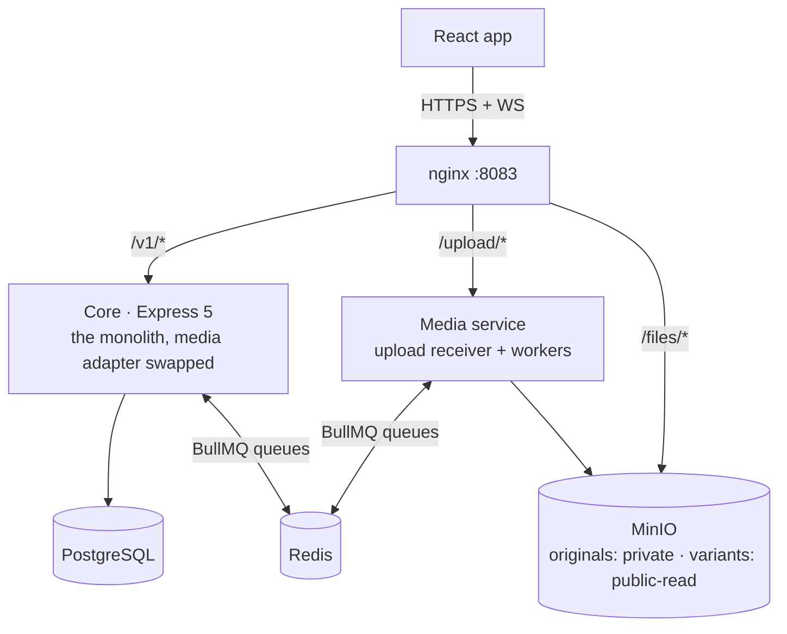

# Monolith + media service

> **Building it?** The step-by-step plan, folder layout and data design are in [docs/hybrid/](../hybrid/).

The [modular monolith](monolith.md) with one capability extracted: a separate media service
that receives file uploads and compresses images and video. The core keeps everything else,
including the `media` table and every `/v1/media/*` endpoint in the contract. It is built
last, after the monolith, and practises the most common real-world move: pulling one
bursty, CPU-heavy module out of a working monolith.

## Shape

The core and the media service share Redis and MinIO but no database and no code. They talk
only through two queues and a signed upload token.

## Stack

| Concern | Core | Media service |
|---|---|---|
| Runtime | Same as the monolith: Express 5, TypeScript, Drizzle, PostgreSQL, Redis | Express 5 + TypeScript, Node 22+ |
| Uploads | Mints signed upload tokens (`jose`, HS256, shared secret) | Streams the request body to MinIO with `@aws-sdk/lib-storage` |
| Validation | Purpose, size and content type against the contract | Byte limit enforced while streaming; file type sniffed from magic bytes (`file-type`) |
| Images | — | `sharp`: thumb / small / medium / large WebP, plus blurhash |
| Video | — | FFmpeg (child process): poster frame + HLS ladder |
| Messaging | BullMQ producer for `media.process`, consumer for `media.results` | The reverse |
| Database | Owns `media`, `media_variants` | None. Job state lives in BullMQ; output keys are deterministic |

The media service starts in TypeScript on purpose: moving the monolith's existing media code
into its own process, unchanged, is the extraction exercise. Rewriting it in Rust or Go
(as `media-svc` in the [microservices](microservices.md) build) is a separate, optional step
once it runs on its own.

## The seam

In the monolith, `modules/media` uses a local BullMQ worker running sharp. The hybrid core
is the same codebase with only that module's `infra` adapter swapped:

| | Monolith | Hybrid core |
|---|---|---|
| `createMediaUpload` | Pre-signed MinIO PUT URL | Signed URL pointing at the media service |
| `completeMediaUpload` | Enqueue a local sharp job | Enqueue `media.process` for the media service |
| `media.ready` | Emitted by the local worker | Emitted when the core consumes a `media.results` message |

`modules/media/index.ts` does not change, and no other module notices. If anything outside
`modules/media` has to change, the boundary was in the wrong place, which is useful to learn.

## How it handles the hard parts

| Flow | Implementation |
|---|---|
| Start upload | Core validates the request, inserts `media` (`pending`) and returns `uploadUrl = http://localhost:8083/upload/{mediaId}?token=…` (absolute: the contract types it as a URI). The token carries `mediaId`, `ownerId`, `contentType`, `maxBytes` and a 15-minute `exp`. No call to the media service, so it can be down and posting text still works |
| Receive bytes | The media service verifies the token, streams the body to `originals/{mediaId}`, aborts with 413 past `maxBytes` and 415 if the sniffed type differs from the token. Bytes never touch the core. The browser PUTs cross-origin with XHR, so `/upload/*` must answer CORS preflights for `http://localhost:5173` (`PUT` plus the `headers` the core returned) |
| Complete | Core sets `processing` and writes an outbox row for `media.process` in the same transaction; the relay enqueues it. Returns 202 |
| Process | The worker checks the original exists (otherwise the result is `failed: missing_upload`), writes variants to `variants/{mediaId}/{name}`, then enqueues `media.results` with dimensions, duration, blurhash and the variant list |
| Ready | The core consumer upserts `media_variants`, sets `ready` or `failed` and emits `media.ready` on the in-process event bus, exactly as the monolith did |
| Idempotency | Deterministic output keys and a BullMQ `jobId` of `mediaId` make redelivery safe; the core ignores results for media that is already `ready` |
| Separate lanes | Images and video use separate queues with different concurrency, so one long video cannot starve thumbnails |
| Cleanup | A repeatable core job finds unattached media older than 24 h, deletes the rows and enqueues `media.delete` for the objects |
| Serving | Variants come from MinIO's public-read prefix through nginx `/files/*` with long cache headers; originals stay private |

## Failure modes worth testing

| What breaks | What users see |
|---|---|
| Media service down | Uploads fail with a network error; the feed, chat and text posts are unaffected |
| Workers down, receiver up | Uploads succeed and wait in `processing`; the queue drains when workers return |
| Core down | Everything is down except in-flight processing, whose results wait in `media.results` |
| A poison file crashes sharp | BullMQ retries with backoff, then marks the job failed; the core receives `failed` and the post composer shows it |

## Scaling path

1. Scale media workers on CPU load, independently of the core. This is the reason for the split.
2. Put the upload receiver and the workers in separate processes, so slow clients uploading
   200 MB videos do not hold worker memory.
3. Move video to its own worker pool (or machine) with FFmpeg hardware acceleration.
4. Extract the next module only if it has the same reasons: different load, different failure
   profile or a different release cadence.

## Trade-offs

| Good | Costs |
|---|---|
| CPU-heavy, bursty work scales and fails on its own | Two deployables, a shared secret and a queue protocol to version |
| The core stays a simple monolith with real transactions | `ready` is now eventually consistent across a process boundary |
| Upload validation sits right where bytes arrive | Shared Redis and MinIO are still coupling, and still single points of failure |
| Much cheaper than a full microservices split | Two places to look when an upload goes wrong; needs correlation ids in both logs |

## Practice checklist

- [ ] `getHealth` LIVE, returning `architecture: "hybrid"`
- [ ] Swap the monolith's media adapter without touching any other module
- [ ] Signed upload token; reject expired, tampered and oversized uploads
- [ ] Outbox → `media.process`; kill the media service mid-job and prove the job finishes after restart
- [ ] Duplicate a `media.results` message and verify nothing changes
- [ ] Stop the media service and confirm text posts, chat and the feed keep working
- [ ] Load-test 50 concurrent image uploads with k6; scale workers and compare p95 to the monolith
- [ ] One correlation id traced from `POST /media/uploads` through both processes' logs
