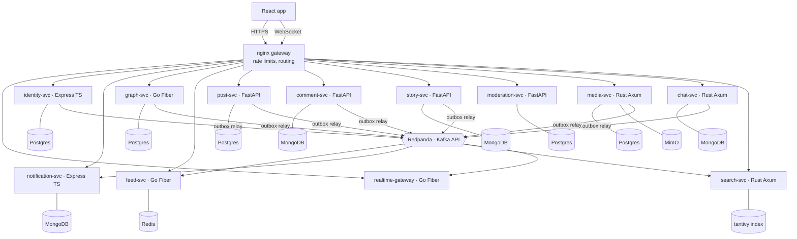

# Microservices (Express TS · Go Fiber · Rust Axum · Python FastAPI)

> **Building it?** The step-by-step plan, folder layout and data design are in [docs/microservices/](../microservices/).

Independently deployable services, each owning its own PostgreSQL or MongoDB database,
behind the same nginx gateway as the other architectures. Services use gRPC for reads and
Kafka events (on Redpanda) for everything else. Boundaries follow the monolith's modules.

## Shape

## Services

| Service | Language / framework | Database | Why this pairing |
|---|---|---|---|
| identity-svc | Express TS | PostgreSQL | Credentials and tokens need constraints and transactions |
| notification-svc | Express TS | MongoDB | Flexible payload per notification type; TTL index for old items |
| graph-svc | Go Fiber | PostgreSQL | Hot, simple reads: followers and following with keyset pagination |
| feed-svc | Go Fiber | Redis | High-volume fan-out; goroutines suit batched writes |
| realtime-gateway | Go Fiber (`gofiber/contrib/websocket`) | Redis (connection registry) | Many long-lived connections per process |
| post-svc | Python FastAPI | PostgreSQL | Relational posts, likes, shares, bookmarks |
| comment-svc | Python FastAPI | MongoDB | A thread is a natural document set; one query per thread |
| story-svc | Python FastAPI | MongoDB | TTL index deletes stories after 24 h with no cron job |
| moderation-svc | Python FastAPI | PostgreSQL | Report workflow; room for ML classifiers later |
| media-svc | Rust Axum | PostgreSQL + MinIO | CPU-heavy image work with the `image` crate; FFmpeg for video |
| chat-svc | Rust Axum | MongoDB | Write-heavy messages, grouped by conversation |
| search-svc | Rust Axum | tantivy (embedded) | A full-text engine written in Rust, fed from Kafka |

### Libraries per language

| | HTTP | gRPC | Kafka | PostgreSQL | MongoDB |
|---|---|---|---|---|---|
| TypeScript | Express 5 | `@grpc/grpc-js` + `ts-proto` | `@confluentinc/kafka-javascript` | Drizzle | `mongodb` driver |
| Go | Fiber v3 | `grpc-go` | `franz-go` | `pgx` + `sqlc` | `mongo-go-driver` v2 |
| Rust | Axum + Tokio | `tonic` | `rdkafka` | `sqlx` | `mongodb` crate |
| Python | FastAPI + Pydantic v2 | `grpcio` | `aiokafka` | SQLAlchemy 2 async + `asyncpg`, Alembic | PyMongo async |

The four-language mix is deliberate practice. A real team would usually standardise on one or two.

## How it handles the hard parts

| Flow | Implementation |
|---|---|
| Feed | feed-svc consumes `post.created` (partitioned by author id), pages followers from graph-svc over gRPC and pipelines `ZADD`s. Hydration calls post-svc `BatchGetPosts` |
| Consistency | Each service writes an outbox row in the same transaction (Postgres) or the same multi-document transaction (MongoDB replica set). A relay publishes to Kafka. Consumers record processed event ids, so redelivery is harmless |
| Chat | chat-svc stores `{ conversationId, _id: <ulid> }` documents (index `{conversationId: 1, _id: -1}`) and emits `message.created`; realtime-gateway processes look up the user's process in Redis and push |
| Stories | story-svc stores an `expiresAt` field with a TTL index; MongoDB removes expired stories itself |
| Account deletion | Choreographed saga: `user.deleted` → every service purges its data and emits `*.purged`; identity-svc completes once all have reported |
| Composition | nginx only routes, so a response that needs several services is assembled by the owning service (e.g. feed-svc hydrates posts from post-svc); call depth is at most 2 |
| Resilience | Deadlines, retries with jitter and circuit breakers in every gRPC client; nginx marks failing upstreams down (`max_fails`) |
| Observability | OpenTelemetry in all four languages → Jaeger; Prometheus + Grafana for RED metrics |

## Running locally (no cloud)

- `docker compose` starts Redpanda, one PostgreSQL container with five databases, MongoDB as
  a single-node replica set (needed for transactions and change streams), Redis, MinIO and
  Jaeger.
- Services run with their own hot reload: `tsx watch`, `air` (Go), `cargo watch` (Rust),
  `uvicorn --reload` (Python).
- Protobuf contracts live in `proto/` and are generated per language with `buf generate`.
- Optional second phase: k3d (Kubernetes in Docker) with one Helm chart per service.

## Trade-offs

| Good | Costs |
|---|---|
| Scale and deploy each service independently | Network calls fail in ways function calls never do |
| Best language and database per problem | No cross-service transactions; eventual consistency |
| Fault isolation: a broken search does not stop chat | Four toolchains, four CI pipelines, shared protobufs |
| Small codebases | Debugging needs distributed tracing |

## Practice checklist

- [ ] nginx routes to identity-svc; JWT validated at the edge or in each service
- [ ] One `.proto` used from Go, Rust, Python and TypeScript
- [ ] Outbox relay for post-svc; kill it mid-stream and prove nothing is lost
- [ ] Idempotent feed consumer; replay a topic and verify no duplicates
- [ ] MongoDB TTL index for stories, transaction for chat
- [ ] Kill a realtime-gateway container and watch clients reconnect with `resume`
- [ ] Follow one feed request across nginx → feed-svc → post-svc in Jaeger
