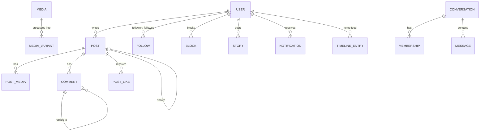
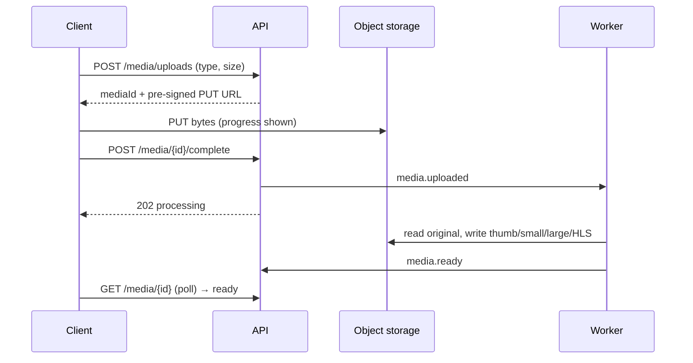

# System design

The product requirements and core flows every architecture has to satisfy. The architecture
documents describe *how* each one does it.

## Requirements

**Functional**

- Register, sign in, rotate tokens, sign out.
- Profiles; follow, unfollow, block; "people you may know".
- Posts with text and up to 10 photos or videos, visibility (everyone / followers / only me),
  likes, shares, bookmarks, edits with optimistic concurrency.
- Threaded comments, one reply level, with likes.
- Stories that expire after 24 hours, with seen state.
- Direct and group chat: history, delivery in under a second, typing, read markers.
- In-app notifications, aggregated ("Ada and 4 others liked your post"), with per-type
  preferences for in-app, email and push.
- Search across people, posts and hashtags; trending hashtags.
- Reports for moderation.

**Non-functional (targets for a realistic exercise, not a laptop)**

| | Target |
|---|---|
| Users | 10 M registered, 1 M daily active |
| Feed read latency | p99 < 200 ms |
| Message delivery | p99 < 1 s sender → recipient |
| Availability | 99.9 % for reads; writes may degrade before reads do |
| Consistency | Read-your-writes for your own posts; eventual for everyone else's feed |
| Media | Up to 15 MB images, 200 MB video; never proxied through the API |

## Back-of-the-envelope

| Quantity | Estimate |
|---|---|
| Posts | 1 M DAU × 0.5 posts/day = 500 k/day ≈ **6 writes/s**, peak ×5 ≈ 30/s |
| Feed reads | 1 M × 10 opens/day = 10 M/day ≈ **115 reads/s**, peak ≈ 600/s |
| Fan-out writes | 30 posts/s × 200 avg followers = **6 k timeline inserts/s** at peak |
| Messages | 1 M × 20/day = 20 M/day ≈ 230/s, peak ≈ 1.2 k/s |
| Concurrent sockets | ~10 % of DAU online ≈ **100 k connections** |
| Media | 500 k posts × 40 % with media × 2 MB ≈ 400 GB/day before variants |

The read/write ratio (~20:1) and the fan-out multiplier are what drive the feed design.

## Data model

Access patterns that matter most:

1. Home timeline for user U, newest first, paginated → precomputed per-user timeline.
2. Posts by author A, newest first → index on `(author_id, id desc)`; ULIDs sort by time.
3. Messages in conversation C, newest first → partition by conversation, cluster by message id.
4. Unread counts for U → counters maintained on write, not counted on read.

## Core flows

### Home feed: hybrid fan-out

- **Fan-out on write** for normal authors: on `post.created`, push the post id into each
  follower's timeline (capped at ~800 entries).
- **Fan-out on read** for authors above a follower threshold (say 10 k): their posts are merged
  into the timeline when it is read, so one celebrity post does not cause a million writes.
- Hydration: the timeline stores ids only; posts, authors and viewer state (liked, bookmarked)
  are fetched in batches and cached.
- New follow → backfill the last N posts of that author; unfollow/block → filter at read time
  and clean up lazily.

### Media upload

Bytes never pass through the API. Unattached uploads are garbage-collected after 24 hours.

### Chat delivery

1. Client sends `POST /conversations/{id}/messages` with a `clientMessageId` (idempotency and
   optimistic UI).
2. The message is stored, then `message.created` is published.
3. The realtime layer looks up which socket gateways hold connections for each member and
   pushes the event. Offline members get a push notification instead.
4. The client reconciles its optimistic bubble by `clientMessageId`. On reconnect it sends
   `resume` with the last event id; gaps older than 5 minutes are refilled over REST.

### Notifications

Producers emit domain events (`post.liked`, `comment.created`, `user.followed`, …). The
notification consumer aggregates by `(recipient, type, target)` while unread, stores the inbox
entry, updates the unread counter, and then fans out to channels according to preferences.

## Cross-cutting

| Concern | Approach |
|---|---|
| Auth | Short-lived JWT access token + rotating refresh token with reuse detection |
| Idempotency | `Idempotency-Key` on creates, stored 24 h with the response |
| Concurrency | `ETag` / `If-Match` on edits |
| Rate limiting | Token bucket per user and per IP at the edge; `429` + `Retry-After` |
| Observability | OpenTelemetry traces (W3C `traceparent`), `traceId` returned in problem responses |
| Events | Transactional outbox, so an event is published if and only if the write commits |
| Privacy | Block and visibility checks on every read path, including search and notifications |
